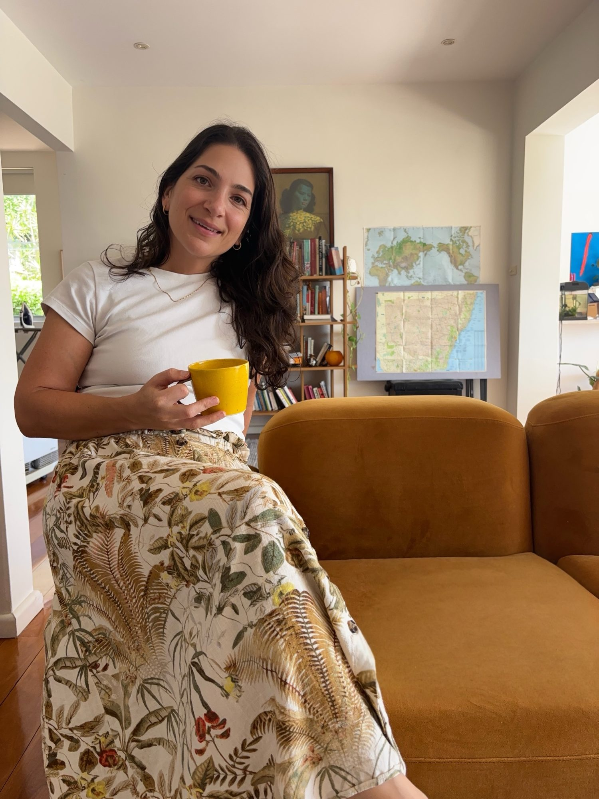

# Back to Breath Website
## backtobreath.net.au — Cloudflare Pages

---

## File structure

```
backtobreath/
├── index.html         ← Home page
├── about.html         ← About page
├── contact.html       ← Contact page
├── style.css          ← Global styles (nav, footer, buttons, etc.)
├── home.css           ← Home page specific styles
├── about.css          ← About page specific styles
├── contact.css        ← Contact page specific styles
└── images/            ← CREATE THIS FOLDER and drop your photos in
```

---

## How to add your photos

Search the HTML files for `PHOTO SLOT` comments. Each one tells you exactly:
- which image file to use
- what size works best
- what to replace the placeholder div with

**Quick example** ... find this in index.html:
```html
<!-- PHOTO SLOT 1 — HERO BACKGROUND -->
<div class="photo-placeholder hero__photo-placeholder"> ... </div>
```

Replace the whole `<div class="photo-placeholder ...">` block with:
```html

```

### Photo slots summary

| Slot | File to use | Location | Size |
|------|-------------|----------|------|
| 1 | images/hero-bg.jpg | Home hero background | 1920 × 1080px |
| 2 | images/lucine-portrait.jpg | Home about preview | 800 × 1000px |
| 3 | images/tools-card.jpg | Home tools card | 600 × 400px |
| 4 | images/onetoone-card.jpg | Home 1:1 card | 600 × 400px |
| 5 | images/community-card.jpg | Home membership card | 600 × 400px |
| 6 | images/about-main.jpg | About main image | 960 × 720px |
| 7 | images/about-secondary.jpg | About secondary | 400 × 530px |
| 8 | images/strip-1.jpg | About photo strip left | 600 × 380px |
| 9 | images/strip-2.jpg | About photo strip middle | 600 × 380px |
| 10 | images/strip-3.jpg | About photo strip right | 600 × 380px |

---

## Deploying to Cloudflare Pages

1. Go to [pages.cloudflare.com](https://pages.cloudflare.com)
2. Create a new project and choose **Direct Upload**
3. Upload this entire folder (all HTML, CSS, and your images folder)
4. Cloudflare will give you a `.pages.dev` URL to preview

### Connecting your domain (backtobreath.net.au)

Since your domain is managed through Cloudflare already:

1. In your Pages project go to **Custom Domains**
2. Add `backtobreath.net.au` and `www.backtobreath.net.au`
3. Cloudflare will automatically update the DNS to point to your Pages site
4. SSL is automatic and free

Once that's live you can cancel your Squarespace subscription.

---

## Contact form

The contact form currently shows a success message on submit but doesn't actually send anything. To wire it up, the easiest free option is **Formspree**:

1. Sign up at formspree.io and create a new form
2. You'll get a form endpoint like `https://formspree.io/f/abcdefgh`
3. In contact.html, replace the `handleSubmit` function with:

```javascript
async function handleSubmit() {
  const name = document.getElementById('name').value.trim();
  const email = document.getElementById('email').value.trim();
  const interest = document.getElementById('interest').value;
  const message = document.getElementById('message').value.trim();
  if (!name || !email || !message) {
    alert('Please fill in your name, email, and message.');
    return;
  }
  const res = await fetch('https://formspree.io/f/YOUR_FORM_ID', {
    method: 'POST',
    headers: { 'Content-Type': 'application/json' },
    body: JSON.stringify({ name, email, interest, message })
  });
  if (res.ok) {
    document.getElementById('contactForm').style.display = 'none';
    document.getElementById('formSuccess').style.display = 'block';
  }
}
```

Formspree free plan allows 50 submissions per month. Paid is $10/month for unlimited.

---

## To update content

All text is plain HTML. Just open the file in any text editor, find the section you want to change, and edit the text directly. No CMS, no logins, no platform fees.

For anything bigger (adding new pages, new sections) just ask!

---

## Update: Back to Baseline, retreat waitlist, Flodesk

New and changed files
- `baseline.html`: Back to Baseline sales page (join buttons go to Heartbeat, plus a waitlist form).
- `retreat.html`: retreat waitlist with the "Sydney day or full weekend" question.
- `site.js`: shared scripts and the two settings you may edit (top of file): `BASELINE_JOIN_URL`, `WAITLIST_ENDPOINT`.
- `worker/waitlist-worker.js`: Cloudflare Worker that adds waitlist sign ups to Flodesk segments.
- `mosman-september.html` now redirects to `retreat.html`.

Flodesk setup (one time)
1. In Flodesk create segments "Retreat waitlist" and "Baseline waitlist". Copy each segment ID.
2. Cloudflare dashboard, Workers, create a Worker, paste in `worker/waitlist-worker.js`.
3. Add secrets: `FLODESK_API_KEY`. Add variables: `SEGMENT_RETREAT`, `SEGMENT_BASELINE`, `ALLOWED_ORIGIN` (https://backtobreath.net.au). Optional: `SEGMENT_RETREAT_DAY`, `SEGMENT_RETREAT_WEEKEND` to also tag by format.
4. Optional: in Flodesk add a custom field `retreat_format` to keep the day/weekend answer.
5. Paste the Worker URL into `WAITLIST_ENDPOINT` in `site.js` and redeploy.
Until then the forms open a pre filled email to you, so nothing is lost.

Images: keep your existing `images/` folder and add `yanada-mist.jpg`.


---

## Update: ADHDecompress, The ADHD Capacity Program waitlist (replaces Back to Baseline and 1:1)

New and changed files
- `adhdecompress.html`: the 2 week intro (always open). Replaces Back to Baseline.
- `adhd-capacity-program.html`: waitlist only page for the 6 month program.
- `baseline.html` now just redirects to `adhdecompress.html` (so old links still work).
- `site.js`: settings at the top are now `DECOMPRESS_JOIN_URL` and `DECOMPRESS_PRICE`. While the join link is empty, every Join button says "Join the waitlist". Fill both in to open ADHDecompress (the price section appears automatically).
- Nav, footers, home, shop, contact and about updated. 1:1 sessions and the perimenopause promotion are removed from the site (the perimenopause article page still exists but is no longer linked).

Waitlist set up
- ADHDecompress waitlist reuses the existing `baseline` list / `SEGMENT_BASELINE` in the Worker.
- The Program waitlist sends `list: "program"`. Add a Flodesk segment "Program waitlist", add `SEGMENT_PROGRAM` to the Worker and map `program` to it. Until then, if the Worker rejects it, the form falls back to a pre filled email so nobody is lost.
- The optional "what do you most want help with" answer is sent as `struggle`.
